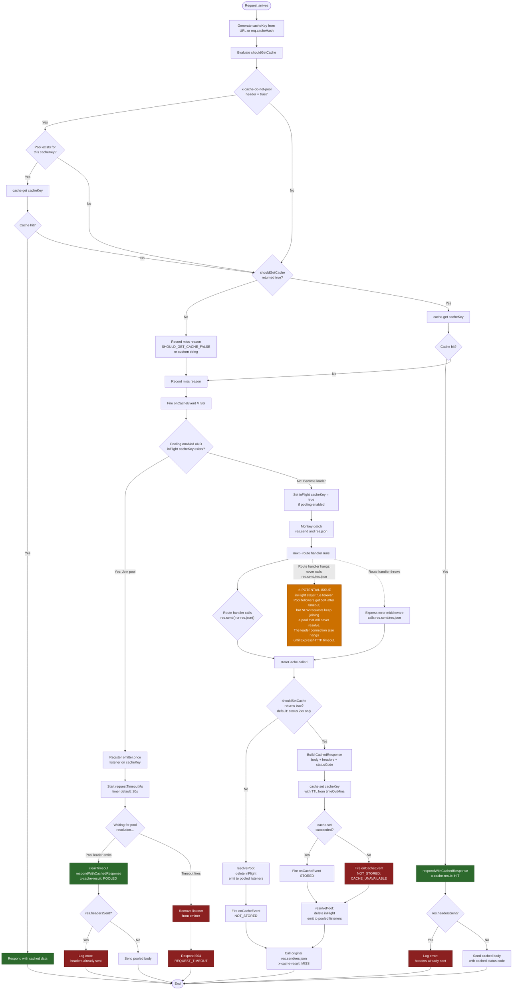

# Express Cache Middleware Flow

## Potential Issue: Pool Never Returns

There is **one scenario** where the pool can get permanently stuck:

### Route handler hangs and never calls `res.send()` / `res.json()`

If the downstream route handler (invoked via `next()`) never sends a response — due to a hang, infinite loop, deadlock, or simply forgetting to respond — then:

- `storeCache()` is never called
- `resolvePool()` is never called
- `inFlight[cacheKey]` is **never deleted**
- The emitter event for `cacheKey` is **never fired**

**Consequence:** Pool followers that are already waiting will correctly time out after `requestTimeoutMs` (default 20s) and get a 504. However, **new requests** that arrive after those timeouts will still see `inFlight[cacheKey] === true` and join a pool that will never resolve. Each new joiner will wait `requestTimeoutMs` then 504, indefinitely, until the process restarts.

The pool leader's own connection will hang until Express or the HTTP server's own timeout closes it (which does **not** clean up `inFlight`).

### What about thrown errors?

If the route handler throws, Express's error middleware will typically call `res.send()` or `res.json()` to send an error response. Since these are the **patched** versions, `storeCache` and `resolvePool` fire normally and the pool resolves. This is not a stuck-pool scenario.

### Suggested mitigations

- **Add a `res.on("close")` or `res.on("finish")` listener** in the leader path that cleans up `inFlight[cacheKey]` and emits to the pool if `resolvePool` was never called. This covers all edge cases (timeouts, aborted connections, hangs).
- **Alternatively, add a leader-side timeout** that calls `resolvePool` and cleans up `inFlight` if the route handler doesn't respond within `requestTimeoutMs`.
